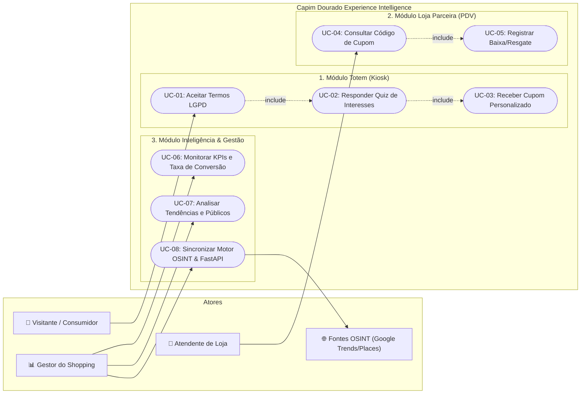
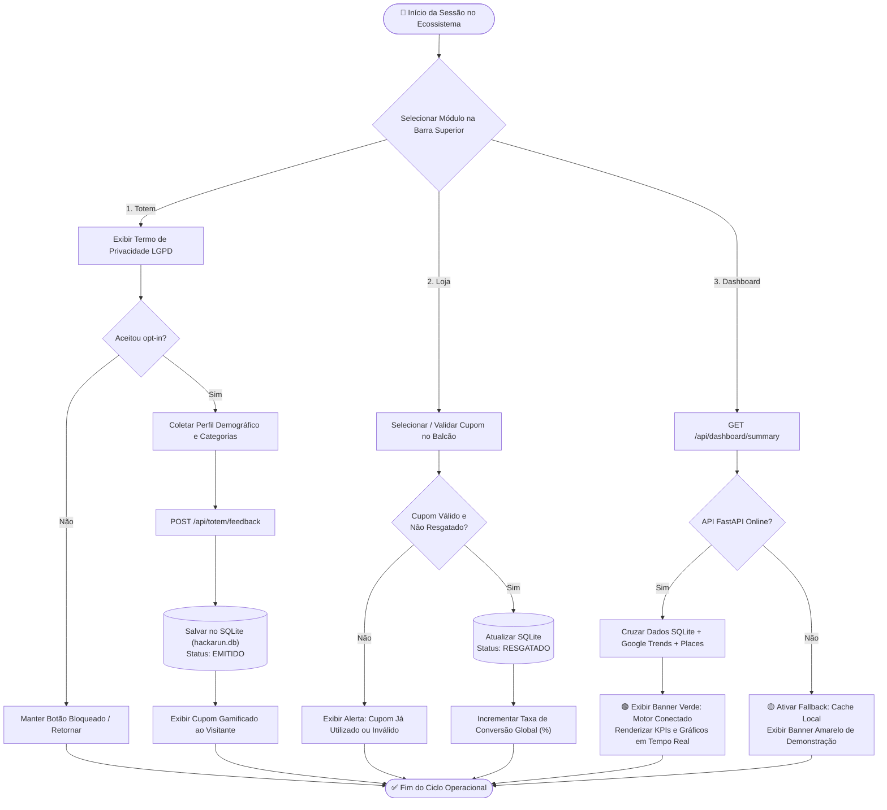

# 🌾 Capim Dourado Experience Intelligence


Plataforma de inteligência comportamental e conversão phygital desenvolvida pela **Equipe Ampharos** para o **Capim Dourado Shopping** (Hackarun). O sistema integra coleta gamificada *first-party* (Totem Kiosk), atribuição de vendas em lojas parceiras (PDV) e motor analítico de dados abertos (**OSINT** via Google Trends e Google Places).

---

## 🔗 Links Oficiais e Demonstração

- 🌐 **Aplicação Web (Vercel - Produção):** [https://hackarun-ampharos.vercel.app](https://hackarun-ampharos.vercel.app)
- ⚙️ **API Backend (Render - Cloud):** [https://hackarun-equipe-ampharos.onrender.com/docs](https://hackarun-equipe-ampharos.onrender.com/docs)
- 🩺 **Health Check da API:** [https://hackarun-equipe-ampharos.onrender.com/health](https://hackarun-equipe-ampharos.onrender.com/health)
- 🎥 **Vídeo Pitch / Demonstração (YouTube):** [Assista aqui](https://youtu.be/0nyy2pfhUfs)

---

## 🏗️ Arquitetura do Sistema e Estrutura de Diretórios

O projeto adota separação estrita de responsabilidades (**Clean Architecture / MVVM** no Frontend e ** Camadas de Serviço/Repositório** no Backend):

```text
Hackarun-equipe-ampharos/
├── backend/                        # Servidor Python 3.12 + FastAPI
│   ├── app/
│   │   ├── main.py                 # Entrypoint, rotas REST e configuração CORS
│   │   ├── models.py               # Modelos ORM SQLAlchemy (TotemFeedback, OSINT)
│   │   ├── schemas.py              # Contratos de validação Pydantic
│   │   └── services/               # Motor de ingestão Google Trends (CSV) & Places
│   ├── tests/                      # Suíte de testes automatizados (Pytest)
│   ├── hackarun.db                 # Banco de dados relacional SQLite
│   └── requirements.txt            # Dependências do servidor
└── lib/                            # Aplicação Multiplataforma Flutter (Web/Kiosk)
    ├── core/
    │   └── di/service_locator.dart # Injeção de Dependências manual
    ├── data/
    │   ├── models/                 # Modelos de dados e serialização JSON
    │   ├── repositories/           # Orquestração API vs. Fallback Cache Local
    │   └── services/               # Cliente HTTP (IntelligenceApiService)
    ├── design_system/              # Tokens visuais (app_colors, app_typography, KPIs)
    └── scenes/                     # Módulos MVVM (1. Totem, 2. Loja, 3. Dashboard)
```

---

## 📋 1. Engenharia de Requisitos (ISO/IEC/IEEE 29148)

### 1.1 Requisitos Funcionais (RF)

| ID | Requisito | Descrição Técnica | Prioridade | Módulo |
| :--- | :--- | :--- | :--- | :--- |
| **RF-01** | **Consentimento LGPD** | Apresentar termos de uso de dados anonimizados e exigir aceite explícito (`opt-in`) antes de iniciar a jornada no quiosque. | Alta | `1. Totem` |
| **RF-02** | **Coleta Gamificada** | Capturar perfil de visita e categorias de interesse (Gastronomia, Moda, Tecnologia, Música, Cultura, Entretenimento) em até 3 toques. | Alta | `1. Totem` / `API` |
| **RF-03** | **Emissão de Cupom** | Gerar código promocional único pareado com a categoria de interesse do visitante e persistir no SQLite com status `EMITIDO`. | Alta | `API (FastAPI)` |
| **RF-04** | **Baixa de Cupom em Loja** | Validar código no balcão da loja parceira e alterar status para `RESGATADO`, registrando data/hora de conversão. | Alta | `2. Loja` / `API` |
| **RF-05** | **Ingestão Google Trends** | Processar séries temporais (CSV/API) para mensurar o volume de interesse sazonal por categoria na região de Palmas-TO. | Média | `Motor OSINT` |
| **RF-06** | **Análise Google Places** | Extrair avaliações públicas e classificar polaridade de sentimento e recorrência de temas citados pelos clientes. | Média | `Motor OSINT` |
| **RF-07** | **Dashboard Executivo** | Exibir KPIs em tempo real: Consumidores, Categorias Monitoradas, Maior Interesse, Crescimento (p.p.) e Taxa de Resgate de Cupons. | Alta | `3. Dashboard` |
| **RF-08** | **Contingência Offline** | Chavear automaticamente para Cache Local de demonstração caso a API esteja indisponível, sinalizando o estado via banner na UI. | Alta | `Core / Repository` |

### 1.2 Requisitos Não Funcionais (RNF)

| ID | Categoria | Especificação | Meta / SLA |
| :--- | :--- | :--- | :--- |
| **RNF-01** | **Padrão Arquitetural** | Frontend estruturado em **MVVM** com Design System próprio e desacoplamento total entre View e camada de serviço. | Zero lógica de negócio nas Views |
| **RNF-02** | **Desempenho** | Resposta rápida nos endpoints de leitura e escrita para operação fluida em telas sensíveis ao toque (Totem). | `< 300ms` (p95) em instância ativa |
| **RNF-03** | **Privacidade (LGPD)** | Coleta *Privacy by Design*: ausência de armazenamento de CPF, nome ou dados sensíveis identificáveis na jornada de quiz. | 100% dos registros anonimizados |
| **RNF-04** | **Interoperabilidade** | Middleware CORS habilitado no FastAPI permitindo comunicação segura entre Vercel (`https`) e Render (`https`). | Suporte a `GET`, `POST`, `PATCH`, `OPTIONS` |
| **RNF-05** | **Testabilidade** | Cobertura de testes automatizados nas rotas críticas do backend e análise estática limpa no Flutter. | `pytest` e `flutter analyze` 100% verdes |

---

## 🎯 2. Modelagem de Casos de Uso

### 2.1 Diagrama de Casos de Uso (Renderização Nativa Mermaid)



### 2.2 Especificação dos Casos de Uso Core

<details>
<summary><b>📌 UC-02 & UC-03: Coletar Perfil Comportamental e Emitir Cupom (Clique para expandir)</b></summary>

- **Ator Primário:** Visitante / Consumidor.
- **Pré-condições:** Totem inicializado na aba `1. Totem`; aceite LGPD confirmado (`UC-01`).
- **Fluxo Principal:**
  1. O visitante informa seu perfil de companhia (Individual, Casal, Família, Amigos) e faixa etária.
  2. O visitante seleciona as categorias de maior interesse no shopping.
  3. O frontend envia `POST /api/totem/feedback` para o backend FastAPI.
  4. O backend grava os dados em `hackarun.db` e retorna o código promocional gerado.
  5. O Totem apresenta o cupom na tela para utilização imediata.
- **Fluxo Alternativo (Fallback Offline):** Se a API não responder dentro do timeout, o `IntelligenceRepository` gera o cupom localmente em cache para não interromper a fila no quiosque físico.
</details>

<details>
<summary><b>📌 UC-05: Registrar Baixa/Resgate de Cupom em Loja (Clique para expandir)</b></summary>

- **Ator Primário:** Atendente de Loja Parceira.
- **Pré-condições:** Cupom previamente emitido no totem; interface aberta na aba `2. Loja`.
- **Fluxo Principal:**
  1. O lojista localiza ou digita o código do cupom apresentado pelo cliente.
  2. O sistema requisita a baixa do cupom na API.
  3. O backend valida que o cupom ainda não foi utilizado (`is_redeemed == False`), registra a conversão e atualiza o cálculo de ROI/Taxa de Resgate do shopping.
- **Fluxo de Exceção:** Caso o cupom já tenha sido resgatado anteriormente, o sistema bloqueia a operação e exibe alerta na interface.
</details>

---

## 🔄 3. Fluxograma de Arquitetura e Processos Ponta a Ponta



---

## 📦 4. Product Backlog (Visão Macro - Priorização MoSCoW)

| Épico | ID | Feature / Entrega de Produto | Valor de Negócio | Prioridade | Status |
| :--- | :--- | :--- | :--- | :--- | :--- |
| **E1: Core & Design System** | `PB-01` | Arquitetura MVVM, Injeção de Dependências e Tokens Visuais Capim Dourado | Padronização visual, manutenibilidade e escalabilidade | **Must Have** | ✅ Concluído |
| **E2: Aquisição (Totem)** | `PB-02` | Autoatendimento gamificado com trava LGPD e geração de benefícios | Coleta de dados primários (*first-party data*) no corredor do shopping | **Must Have** | ✅ Concluído |
| **E3: Atribuição (Loja)** | `PB-03` | Interface de validação e baixa de cupons para lojistas parceiros | Mensuração real de conversão física (*foot-to-store attribution*) | **Must Have** | ✅ Concluído |
| **E4: Motor OSINT & API** | `PB-04` | Backend FastAPI + SQLite integrado a sinais do Google Trends e Places | Combinação de demanda interna com tendências externas da cidade | **Must Have** | ✅ Concluído |
| **E5: Analytics Executivo** | `PB-05` | Dashboard administrativo com KPIs, filtros de período/público e fallback | Suporte direto à tomada de decisão de marketing e mix comercial | **Must Have** | ✅ Concluído |
| **E6: Cloud & DevOps** | `PB-06` | Deploy distribuído (Vercel + Render) e testes automatizados (`pytest`) | Acesso público contínuo e garantia de qualidade nas entregas | **Should Have** | ✅ Concluído |
| **E7: Evolução SaaS** | `PB-07` | Banco PostgreSQL gerenciado na nuvem + Autenticação JWT por lojista | Persistência elástica multi-tenant para operação em escala comercial | **Could Have** | 🗓️ Roadmap |

---

## 🔍 5. Backlog Refinado (Sprint Ready — Padrão INVEST & BDD)

### **US-01: Captura Gamificada no Totem com Conformidade LGPD**
- **User Story:** *Como* visitante do Capim Dourado Shopping, *quero* informar meus interesses rapidamente no totem mediante aceite LGPD, *para que* eu ganhe um cupom de desconto alinhado às minhas preferências.
- **Estimativa:** `5 Story Points` | **Módulo:** `scenes/totem/` + `POST /api/totem/feedback`
- **Critérios de Aceite (Gherkin / BDD):**
  ```gherkin
  Funcionalidade: Coleta de perfil e emissão de cupom no Totem
    Cenário: Emissão de cupom com consentimento LGPD válido
      Dado que o visitante está na tela inicial do "1. Totem"
      E marcou o aceite do termo de privacidade LGPD
      Quando ele selecionar seu perfil e a categoria "Gastronomia" e submeter
      Então a API deve persistir o registro no banco SQLite
      E exibir na tela um código de cupom único com status ativo.

    Cenário: Bloqueio de avanço sem aceite LGPD
      Dado que o visitante não marcou o checkbox de consentimento LGPD
      Quando ele tentar avançar para a seleção de interesses
      Então o botão de ação principal deve permanecer desabilitado.
  ```

### **US-02: Validação de Cupom em Loja e Cálculo de Taxa de Resgate**
- **User Story:** *Como* lojista parceiro, *quero* registrar a baixa do cupom apresentado pelo cliente no balcão, *para que* o desconto seja validado sem duplicidade e o shopping acompanhe a taxa de conversão.
- **Estimativa:** `5 Story Points` | **Módulo:** `scenes/store/` + `API Redeem`
- **Critérios de Aceite (Gherkin / BDD):**
  ```gherkin
  Funcionalidade: Resgate de cupom na Loja Parceira
    Cenário: Baixa de cupom inédito com atualização de KPI
      Dado que um cupom consta com status "EMITIDO" no banco de dados
      Quando o atendente acionar a baixa do cupom na aba "2. Loja"
      Então o status do registro deve ser atualizado para "RESGATADO"
      E o KPI "Taxa de resgate (Cupons)" no Dashboard deve refletir a nova conversão imediatamente.
  ```

### **US-03: Sincronização Híbrida no Dashboard (OSINT + SQLite + Fallback)**
- **User Story:** *Como* gestor de marketing do shopping, *quero* visualizar os indicadores consolidados de público, categorias líderes e sinais externos do Google Trends/Places com resiliência offline, *para que* eu tome decisões embasadas sobre eventos e campanhas.
- **Estimativa:** `8 Story Points` | **Módulo:** `scenes/dashboard/` + `GET /api/dashboard/summary`
- **Critérios de Aceite (Gherkin / BDD):**
  ```gherkin
  Funcionalidade: Painel Administrativo e Resiliência de Conexão
    Cenário: Sincronização online com Motor OSINT & FastAPI
      Dado que o servidor FastAPI está online e acessível
      Quando o gestor abrir a aba "3. Dashboard" ou clicar em "Sincronizar API"
      Então o sistema deve exibir o banner verde "MOTOR OSINT & FASTAPI CONECTADO"
      E atualizar os cards de Consumidores, Categorias, Maior Interesse e Barras de Proporção.

    Cenário: Ativação automática do Modo Demonstração (Fallback)
      Dado que o servidor FastAPI esteja inacessível ou em cold start
      Quando a tentativa de conexão exceder o timeout
      Então a interface deve carregar os dados de cache local sem exibir erros de tela
      E apresentar o banner amarelo informando "MODO DEMONSTRAÇÃO / CACHE LOCAL".
  ```

---

## 🚀 Como Executar o Projeto Localmente

### 1. Subir o Backend (Python / FastAPI)
```powershell
cd backend
python -m venv .venv
.\.venv\Scripts\activate
pip install -r requirements.txt

# Executar suíte de testes automatizados
pytest

# Iniciar servidor na porta 8000
uvicorn app.main:app --reload --host 0.0.0.0 --port 8000
```

### 2. Executar o Frontend (Flutter Web)
Em outro terminal, na raiz do projeto:
```powershell
flutter pub get
flutter run -d chrome
```

---

## 👥 Equipe Ampharos — Engenharia de Software (UniCatólica)
- **Marcus Pires de Castro**
- **Maria Gabriela**
- **Gabriela Ilha**
- - **Luiz**
